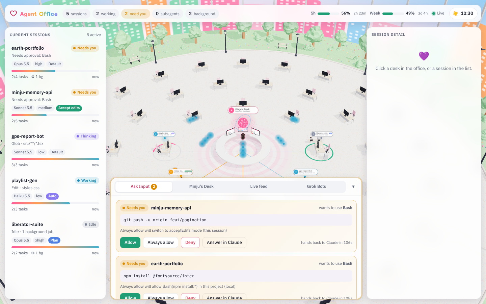

# Agent Office 🏢



A 3D office that shows every Claude Code session on your machine as an agent at a desk.
Minju's round desk sits in the middle: answer permission requests and hand out tasks from there.

The office is a floating island in Minju City's style: terrazzo floor, a garden ring with trees, lamps and benches, a pastel skyline, and white glass panels set in Mali and IBM Plex Sans Thai.

**Time of day.** The clock button in the top bar opens *Atmosphere*:

- **Clock.** Pick Real time (follows this computer), Manual (presets plus a sky-gradient slider), or Time-lapse (a whole day every 2 minutes). Lighting blends between Minju City's six keyframes: night, before dawn, sunrise, day, sunset and dusk. At night the windows, street lamps and desk lamps light up and stars come out.
- **Panels.** *Follow time* switches the panels to dark at night. You can also pin them to Light or Dark.
- **Quality.** *Ultra* gives a 4K shadow map, retina pixel ratio, bushes, flowers and desk props. *Standard* is lighter and is the default on phones.

All settings are remembered in this browser.

It is fed by **Claude Code HTTP hooks**: no SDK, no polling, no transcript parsing.

```
Claude Code (Desktop / CLI) ──http hooks──▶ Bridge 127.0.0.1:7777 ──SSE──▶ 3D dashboard
                            ◀── allow / deny / next task ──┘
```

## Quick start

```bash
npm install
```

```bash
npm start
```

Open the URL it prints. It looks like `http://127.0.0.1:7777/#token=…`.

Try it without real sessions:

```bash
npm run mock
```

Connect your real Claude Code sessions. This edits `~/.claude/settings.json` and writes a backup next to it first. It adds the hooks and the Agent Office **statusline**, which forwards model, effort, context, cost and limits to the office. If you already have a statusline, it keeps running and its output is still what you see. Add `--no-statusline` to install hooks only.

```bash
npm run hooks:install
```

New sessions pick up the hooks. Run `/hooks` inside a session to review them. To remove them:

```bash
npm run hooks:uninstall
```

## What else you see

- **Model, effort and permission mode.** Every session card and desk label shows the model (for example *Opus 5.5*), the effort level, and a coloured permission-mode tag: Plan, Accept edits, Auto, Don't ask, or a red *Bypass*.
- **Usage limits.** The top bar shows the claude.ai **5-hour** and **weekly** windows as bars with a reset countdown. A bar turns amber at 70% and red at 90%. Claude limits aren't hourly: these two rolling windows are what Claude Code reports.
- **Always allow.** When Claude Code offers a permission rule for a request, such as `Bash(npm install:*)` or switching to Accept edits, the Ask Input card shows *Always allow*. The card says exactly what that button saves.
- **Agents move.** New sessions walk in through the arrivals gate to their desk. A session that needs approval runs to Minju's desk and waves until you answer, then walks back. Ended sessions walk out. Walkers follow the aisles and cross a ring of desks only through the gaps between them.
- **The garden is alive.** Trees sway in gusting wind, leaves and petals fall with gravity and drag, the fountain sprays, and birds circle by day.
- **Grok Bots (optional).** A pavilion on the lawn plus a *Grok Bots* dock tab. See [Grok Bot](#grok-bot-optional) below.

`?timescale=3` in the URL speeds up walking and physics. It's handy for demos.

## What each panel reads

| Panel | Hook events |
|---|---|
| Progress bar / floor ring | `TaskCreated`, `TaskCompleted` (falls back to `TodoWrite`) |
| Current sessions / desks | `SessionStart`, `SessionEnd`, `UserPromptSubmit`, `Stop` |
| Subagent mini-desks | `SubagentStart`, `SubagentStop` |
| Background process (server tower) | `PreToolUse` with `run_in_background`, then the authoritative `background_tasks` list on `Stop` |
| Environment trail | `SessionStart`, `CwdChanged`, `PreCompact`/`PostCompact`, `PostModelSwitch`, permission-mode changes |
| Status | latest of `PreToolUse`, `PostToolUseFailure`, `Notification`, `StopFailure` |
| Model / effort | `SessionStart.model`, `effort.level` on tool events, the statusline JSON (and, as a fallback, the newest model named in the transcript) |
| Permission mode | `permission_mode`, present on every event |
| 5-hour / weekly limits | `rate_limits.five_hour` / `seven_day` from the statusline JSON (claude.ai Pro, Max and Ultra plans, after the first reply in a session) |
| Ask Input | `PermissionRequest`: the bridge holds the request until you click |

## How Ask Input and task dispatch work

- **Permissions.** When a dashboard tab is open, the bridge holds a `PermissionRequest` hook and returns your Allow or Deny. If nobody answers within 120 s, or you click *Answer in Claude*, it returns an empty response and Claude shows its normal prompt. With no dashboard open, the bridge never holds anything.
- **Assign a task.** The task is queued and delivered through the `Stop` hook as `additionalContext` when the session's current turn ends. Claude then carries on with it.
- **Standby.** Lets an idle session wait at its desk: its `Stop` hook stays open for up to 9 minutes, so a task you send starts immediately. While on standby, the session looks busy in its own window. Press Esc there to release it.

## Grok Bot (optional)

Grok Bot has no status API, so the office can't read your Bots by itself. Two pieces bridge the gap:

- **Report status in.** Anything that can make an HTTP request posts to the bridge with the dashboard token:

  ```bash
  curl -X POST http://127.0.0.1:7777/api/external/grok \
    -H "Content-Type: application/json" -H "X-Office-Token: $(cat ~/.agent-office/token)" \
    -d '{"bots":[{"id":"sales","name":"Sales Outbound","color":"#FF8FB8","shape":"circle","status":"working","activity":"Drafting emails","progress":{"done":2,"total":6}}]}'
  ```

  `status` is one of working, idle, waiting, error or done. `shape` is one of circle, square, triangle, diamond, star or hexagon. Grok Bots run on a cloud computer, so they can't reach `127.0.0.1` on your machine directly. You need a local script, or a tunnel you control.
- **Start routines.** Copy `examples/external.example.json` to `~/.agent-office/external.json` and fill in each routine's webhook URL and key, from the routine's Webhook section. The *Grok Bots* tab then shows a Run button. The bridge makes the call, so keys never reach the browser. The request body is `{"text": "..."}`. Check it against your routine, because Grok Bot's webhook format isn't verified here.

## Security

- The bridge binds to `127.0.0.1` only. It rejects requests addressed to any other `Host` (DNS rebinding) and dashboard API calls from foreign origins.
- Every dashboard call, including the event stream, Allow/Deny and task dispatch, needs the token in `~/.agent-office/token`. Delete that file to rotate the token.
- `/hook` accepts only `application/json`, which a browser can't send cross-site without a CORS preflight. The bridge never grants one.
- Only short, redacted summaries of tool input are kept and streamed. Full commands appear only on a pending permission card.
- **Don't expose port 7777 to a network.** Allow and task dispatch amount to running commands on this machine.

## Look and performance

- `web/styles.css` holds the panel tokens: `:root[data-theme="light"]` and `:root[data-theme="dark"]`.
- `web/scene.js` holds the scene, plus the time-of-day keyframes (`K_NIGHT` … `K_DUSK`, taken from Minju City's preset values).
- `web/textures.js` draws every texture procedurally: wood, terrazzo, grass, fabric, rock, rug, keyboards, skyline and the live code on each screen. There are no image downloads.
- Desks, chairs, props, trees, flowers, lamps and benches are drawn as `InstancedMesh`, so all 42 desks share a few draw calls. Per-desk meshes are only the live parts: screen, status light, label, and the avatar when someone sits there.
- Add `?stats` to the URL and run `__officeStats()` in the console to see draw calls and triangles.

## Config

| Env var | Default | |
|---|---|---|
| `AGENT_OFFICE_PORT` | `7777` | Also pass `--port` to the hook installer |
| `AGENT_OFFICE_DIR` | `~/.agent-office` | Token and state snapshot |
| `AGENT_OFFICE_APPROVAL_SECONDS` | `120` | Hold time before handing a permission back to Claude |
| `AGENT_OFFICE_STANDBY_SECONDS` | `540` | Must stay under the `Stop` hook timeout (600) |

## Known limits

- Cloud sessions (claude.ai/code) can't reach `127.0.0.1` on your machine.
- A queued task can't reach a session that is idle and not on standby until its next turn ends.
- If the bridge isn't running, hooks fail as non-blocking errors and Claude carries on. Uninstall the hooks when you don't use the office.
